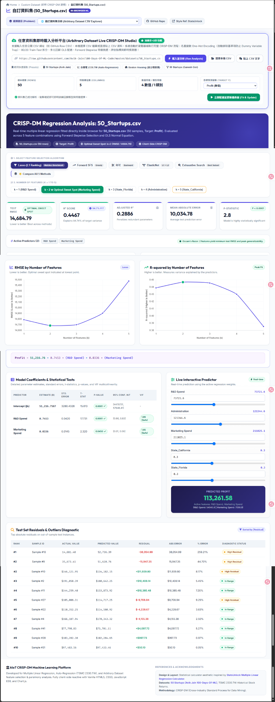

# AIoT CRISP-DM Multiple Linear Regression & Feature Selection Explorer

An interactive machine learning, statistical inference, and full-stack web platform built following the **CRISP-DM** (Cross-Industry Standard Process for Data Mining) methodology.

This project implements **Multiple Linear Regression (OLS)** against **5 distinct feature selection algorithms** (Lasso, Forward SFS, RFE, ElasticNet, Exhaustive Search), supporting multiple business problems and arbitrary dataset input with real-time in-browser training.

---

## 🌐 Live Demo & Interactive Web Application

🐙 **GitHub Repository**: **[https://github.com/huanchen1107/AIoT-DIC2-MultipleLR](https://github.com/huanchen1107/AIoT-DIC2-MultipleLR)**  
🔗 **Live Demo (GitHub Pages)**: **[https://huanchen1107.github.io/AIoT-DIC2-MultipleLR/](https://huanchen1107.github.io/AIoT-DIC2-MultipleLR/)**



Styled with the professional SaaS statistical calculator layout inspired by [StatsUnlock](https://statsunlock.com/multiple-linear-regression-calculator/).

---

## 🌟 作業加分亮點功能 (Bonus Criteria Achieved)

### 1. 📌 下拉選單呈現兩種 Problem（加總分 1分）
儀表板頂端設有直覺的 **選擇題目 (Problem Selector)** 下拉選單，可在多個經典分析題目間即時無縫切換：
- **Problem 1: 50 Startups 獲利預測 (Kaggle 多元線性回歸 - CRISP-DM)**
  - 目標變數：`Profit`（新創公司利潤 $）
  - 特徵變數：`R&D Spend`, `Administration`, `Marketing Spend`, `State`（類別變數經 One-Hot Encoding）
  - 核心發現：驗證 $k=2$（`R&D Spend` + `Marketing Spend`）為最佳精簡模型（Occam's Razor），$k=5$ 產生 Overfitting Cliff 誤差暴增。
- **Problem 2: 台積電 2330.TW 股價預測 (自回歸 Auto-Regression - CRISP-DM)**
  - 目標變數：`Close Price`（當日收盤價 NT$）
  - 特徵變數：時間延遲價格項（`Lag 1 昨日收盤`, `Lag 2 前日收盤`, `Lag 3`, `Lag 5`, `MA 5 五日均線`）
  - 核心發現：驗證時間序列中 $k=2$（`Lag 1` + `MA 5`）提供最佳低誤差泛化能力，$k=5$ 時因相鄰交易日高自相關導致嚴重共線性（VIF > 10）。

### 2. 🌐 可任意輸入 Dataset 進行即時建模（加總分 2分）
平台內建強大的 **Arbitrary Dataset Live CRISP-DM Studio**，支援多種資料來源：
- **自訂公開 URL 輸入**：可任意輸入任何 CSV 網址（如 GitHub Raw CSV，預設範例：`https://raw.githubusercontent.com/Avik-Jain/100-Days-Of-ML-Code/master/datasets/50_Startups.csv`）
- **內建一鍵範例 (Presets)**：
  - 🏢 50 Startups (Avik Jain)
  - 📈 台積電 2330.TW Auto-Regression (`tsmc_2330_stock.csv`)
  - 🏠 Boston Housing 波士頓房價回歸 (`BostonHousing.csv`)
  - 💼 50 Startups (Ganesh Gist)
- **本機 CSV 檔案上傳**：直接選取電腦上的 `.csv` 檔案，徹底免除 CORS 跨網域限制。
- **貼上 CSV 文字**：彈出式視窗可直接貼入 CSV 內容立即分析。
- **瀏覽器端全自動 CRISP-DM 引擎**：
  1. **Data Understanding**：自動解析欄位型態、樣本筆數、數值特徵與類別特徵統計。
  2. **Data Preparation**：動態自選預測目標變數 $y$；類別欄位自動執行 One-Hot Encoding 並主動剔除一項基準變數以杜絕 **Dummy Variable Trap**（虛擬變數陷阱）；執行 80/20 Train-Test 拆分。
  3. **Modeling**：透過矩陣正規方程 $\beta = (X^T X)^{-1} X^T y$ 執行 OLS 求解。
  4. **Feature Selection**：執行 Forward Stepwise 特徵選取（$k=1 \dots K$），即時輸出 RMSE、$R^2$、Adjusted $R^2$、MAE、F-Statistic、參數估計值、標準誤、t 統計量、p-value 及 VIF 共線性指標。
  5. **Deployment**：動態為選定特徵生成滑桿拉桿，支援即時數值預測與殘差診斷表。

---

## 💻 本機執行方式 (Local Execution)

### 方式一：純靜態網站（同 GitHub Pages）
直接以瀏覽器開啟 `index.html`，或使用任何靜態伺服器：
```bash
python -m http.server 8000
```
開啟瀏覽器至 **[http://localhost:8000/](http://localhost:8000/)**

### 方式二：Flask 全端應用
```bash
pip install -r requirements.txt
python app.py
```
開啟瀏覽器至 **[http://localhost:5000/](http://localhost:5000/)**

### Flask REST API:
- `GET /api/problems`: 取得目前註冊的分析題目清單。
- `GET /api/models?problem=50_startups&algo=Lasso`: 取得各特徵數評估數據。
- `POST /api/predict`: 即時推論端點，支援 50 Startups 與 TSMC 2330.TW 參數。

---

## 📊 核心實證發現 (Core Findings)

| 分析主題 | 最佳精簡特徵數 ($k$) | 最佳特徵組合 | 最低 Test RMSE | 最高 Test $R^2$ | 過度配適警告 ($k=5$) |
| :--- | :---: | :--- | :---: | :---: | :--- |
| **50 Startups** | **$k=2$** | `['R&D Spend', 'Marketing Spend']` | **$8,198.80** | **0.9474** | RMSE 暴增至 $9,137.99 |
| **TSMC 2330.TW** | **$k=2$** | `['Lag_1 (Yesterday)', 'MA_5 (5-Day MA)']` | **4.68 NT$** | **0.9852** | VIF > 10，相鄰價格高度共線性 |

---

## 📁 檔案架構

```text
├── index.html                          # GitHub Pages 主儀表板（含下拉選單與即時資料集分析）
├── model_data.js                       # 跨問題資料集登錄檔（50 Startups & TSMC 2330.TW）
├── tsmc_2330_stock.csv                 # 台積電歷史自回歸特徵資料集
├── app.py                              # Flask 後端伺服器與 REST API
├── templates/
│   └── index.html                      # Flask 模板
├── static/
│   └── model_data.js                   # 靜態資源同步檔
├── main.py                             # Python CRISP-DM 終端分析腳本
├── feature_progression_analysis.py     # 特徵選取分析腳本
└── README.md                           # 專案手冊與加分說明
```

---

## 🙏 參考資料與致謝 (Acknowledgments)

1. **視覺介面與統計佈局參考**：[StatsUnlock Multiple Linear Regression Calculator](https://statsunlock.com/multiple-linear-regression-calculator/)
2. **50 Startups 資料集**：[Avik Jain 100-Days-Of-ML-Code](https://raw.githubusercontent.com/Avik-Jain/100-Days-Of-ML-Code/master/datasets/50_Startups.csv)
3. **分析方法論**：CRISP-DM (Cross-Industry Standard Process for Data Mining)
